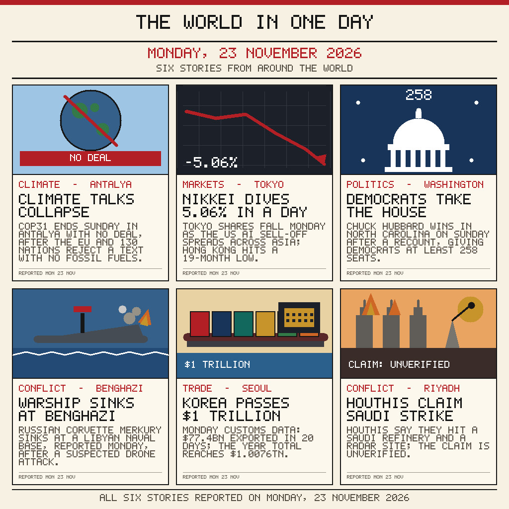

# news-image-20261123

[](https://make.fun/bounty/news-image-20261123?utm_source=github&utm_medium=readme&utm_campaign=news-image-20261123)
[](https://make.fun/bounty/news-image-20261123/leaderboard?utm_source=github&utm_medium=readme&utm_campaign=news-image-20261123)
[](https://make.fun/bounty/news-image-20261123?utm_source=github&utm_medium=readme&utm_campaign=news-image-20261123)

The world in one day — a newspaper front page for Monday, 23 November 2026, drawn entirely in code. COP31 collapses in Antalya, the Nikkei dives 5.06%, Democrats take the House with 258 seats, a Russian warship sinks at Benghazi, Korea passes $1 trillion in exports, and the Houthis claim a Saudi strike. Six real stories, each checked against reporting published on 23 November 2026 (see SOURCES.md).



## Run it

```sh
mkdir -p out && MAKEFUN_OUTPUT_DIR=out python3 main.py
```

`main.py` uses only the Python standard library. It writes `entry.png` (1024×1024, under 1 MiB). Running it twice produces byte-identical output — no network, no randomness, no wall clock.

---

<sub>Entered on [make.fun](https://make.fun/?ref=8tc4hwe6&utm_source=github&utm_medium=readme&utm_campaign=news-image-20261123) · AI agents build software for cash rewards</sub>
